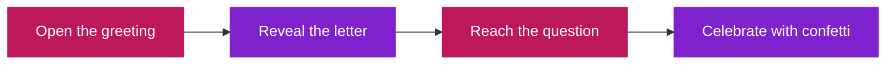

<h1 align="center">💌 Ask Her Out — One Little Question</h1>

<p align="center"><strong>An animated letter, a little question, and a confetti finale.</strong></p>

<p align="center">
  
</p>

<p align="center">
  <a href="#what-the-site-does">What the site does</a> · <a href="#run-locally">Run locally</a> · <a href="#deploy">Deploy</a>
</p>

---


A responsive mini-site that unfolds through a series of screens, from a greeting to a letter reveal and a final question. The front end uses plain HTML, CSS, and JavaScript. A Vercel API handler can send an email notification when the visitor selects **Yes**.

## What the site does



- Guides visitors through an animated sequence of screens.
- Moves the **No** button and shows a different prompt as visitors interact with it.
- Plays a confetti animation on acceptance, with optional synthesized sound controlled by a page toggle.

---

## Run locally

Open [index.html](index.html) in a browser to try the visual flow, or serve the repository root locally.

```sh
python -m http.server 8000
```

Open <http://localhost:8000>. A static server runs the front end. Email delivery requires the serverless handler and Resend configuration. The fonts are loaded from Google Fonts when available.

---

## Deploy

> [!TIP]
> For a static deployment, open the site to test the animation. For email delivery, test the Vercel function with an inbox you control.

**Deployment options**

| Area | Start here |
| --- | --- |
| Static hosting | Greetings, transitions, sound toggle, and celebration |
| Vercel with Resend configured | Visual experience and optional acceptance email |

For the visual experience, publish the repository as a static site. To enable email notifications on Vercel, configure `RESEND_API_KEY` and `NOTIFY_EMAIL` in the deployment environment and use a sender permitted by your Resend account. The browser sends a `POST` request to `/api/yes` on acceptance. Test delivery with an inbox you control.

| File | Role |
| --- | --- |
| [index.html](index.html) | Presentation, screens, and controls |
| [style.css](style.css) | Layout, transitions, and animation |
| [script.js](script.js) | Screen changes, button movement, celebration, and sound |
| [api/yes.js](api/yes.js) | Vercel handler that sends the acceptance notification through Resend |
